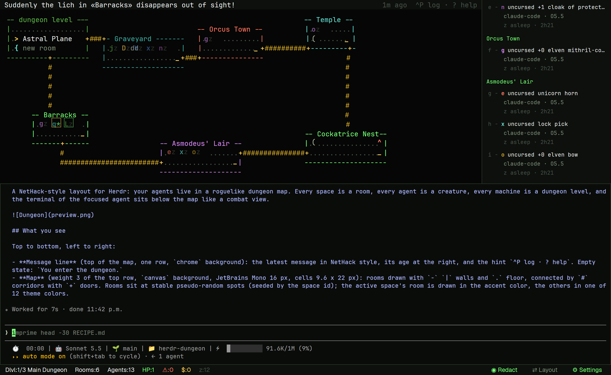

# Dungeon: a NetHack layout for Herdr

Your agents live in a roguelike dungeon. Each space is a room, each agent a creature, each machine a dungeon level, and the focused agent's terminal sits below the map like a combat view.



## Install

Copy the three folders into your Herdr home and switch to the layout:

```sh
cp -r layouts mods themes ~/.config/herdr-app/
herdr-app do layout.switch '{"name":"dungeon"}'
```

`ctrl-shift-l` cycles layouts if you want to go back. The names are all prefixed `dungeon`, so nothing of yours gets overwritten; if one is taken, rename it first. Prefer to have an agent build it? Give it [RECIPE.md](RECIPE.md).

Needs: Herdr with agents that report their status (Claude Code, pi, …). JetBrains Mono ships with Herdr.

## What the symbols mean

| Symbol | Meaning |
|---|---|
| letter (`k o g h n …`) | an agent; always the same monster per agent |
| `*` `!` `$` `z` | working, blocked, done, asleep |
| `d` | its sub-agents |
| `(` | a plain terminal |
| `_` | altar: summon a terminal or an agent in that room |
| `{` | fountain: create a new room (space) |
| `^` | trapdoor: close an empty room (Herdr asks first) |
| `<` `>` | stairs to the previous or next machine |

## Controls

| Input | Action |
|---|---|
| click a creature | focus it; right-click peeks at its terminal |
| double-click a room title | rename the room |
| drag a room title | move the room; right-click the title to reset it |
| click the map, then arrows or `h j k l` | move the selection |
| `Enter` / `p` | focus / peek the selected agent |
| `<` `>` | change level |
| `_` | altar menu of the selected agent's room |
| `Ctrl-P` / `?` / `Esc` | message log / help / close |

The status line has buttons for **Redact** (shows NetHack items instead of terminal titles, NetHack room types instead of space names and dungeon branches instead of machine names; handy for screenshots), **Layout** and **Settings**.

## Good to know

- `dungeon-map` runs `hostname` once to name your local level. No network, no files outside its own folder.
- Closing a room ends the terminals inside it.
- Built and tried on Linux, one display, a handful of rooms and agents. Remote machines (stairs, creating rooms and agents there) have not been exercised; see the *Watch out* section of [RECIPE.md](RECIPE.md) for the full list.
