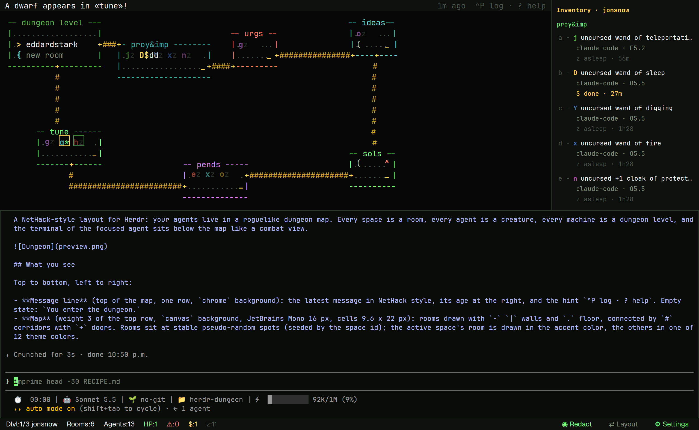

# Dungeon

A NetHack-style layout for Herdr: your agents live in a roguelike dungeon map. Every space is a room, every agent is a creature, every machine is a dungeon level, and the terminal of the focused agent sits below the map like a combat view.

## What you see

Top to bottom, left to right:

- **Message line** (top of the map, one row, `chrome` background): the latest message in NetHack style, its age at the right, and the hint `^P log · ? help`. Empty state: `You enter the dungeon.`
- **Map** (weight 3 of the top row, `canvas` background, JetBrains Mono 16 px, cells 9.6 x 22 px): rooms drawn with `-` `|` walls and `.` floor, connected by `#` corridors with `+` doors. Rooms sit at stable pseudo-random spots (seeded by the space id); the active space's room is drawn in the accent color, the others in one of 12 theme colors.
- **Inventory** (right column, 300 px, `chrome` background): `Inventory · <level>`, then the agents of the current level grouped by room, one entry each: a letter (`a -`), the creature, the terminal title, the program and short model, and the state with the time spent in it.
- **Combat** (bottom, weight 1 of the column, bordered): the focused agent's terminal at full size.
- **Status line** (28 px): `Dlvl:<n>/<total> <machine>  Rooms  Agents  HP  ⚠  $  z`, then `◐ Redact`, `⇄ Layout` and `⚙ Settings` buttons on the right.

Symbols on the map:

| Symbol | Meaning |
|---|---|
| letter (`k o g h n e S D L T C Y x j B q`) | an agent; the species is a hash of its address, so an agent is always the same monster. The color is also by identity |
| `*` / `!` / `$` / `z` next to it | working / blocked / done / asleep (asleep creatures are dimmed) |
| `d` after a creature | its sub-agents (up to two shown) |
| `(` | a plain terminal (no agent status) in that room |
| `_` | altar, bottom-right of each room |
| `^` | trapdoor, top-right, only in rooms with no agents |
| `{` | fountain inside the `dungeon level` room |
| `<` `>` | stairs to the previous / next machine, in the `dungeon level` room, with the destination's urgency (`!2 $1 *3`) |

## How it behaves

Agent states: `working` creatures pulse slowly; `blocked` ones pulse fast with a red `!`; `done` shows a gold `$`; `idle` shows a dim `z` and the creature at 55% opacity. The status line counts the same states across all levels.

Mouse:
- Click a creature: `agent.focus` (the combat view follows). Right-click: `terminal.peek`.
- Click `(`: `terminal.peek` on that terminal.
- Click the altar `_`: a popup `Summon at the altar…` listing `terminal` plus every installed agent from `knownAgents()`; picking one runs `tab.new` in that room's space without changing focus.
- Click the fountain `{ new room`: `space.new` on the current level's machine, without changing focus.
- Click the trapdoor `^`: `space.close`; Herdr asks for confirmation itself because `confirmed` is not passed. The room's terminals end.
- Double-click a room title: `space.rename` (Herdr prompts for the name).
- Drag a room title: moves the room (a ghost outline follows the pointer: green if free, red if it would overlap another room; dropping on another room cancels). Corridors re-route by themselves. Right-click a title to send that room back to its seeded spot. Positions persist per space.
- Click `>` or `<` in the `dungeon level` room: switch level. A level whose machine is not `ready` shows `?` and cannot be entered. If the machine you are on stops being ready, the map returns to the local level.

Keyboard (click the map first so it has focus): arrows or `h j k l` move the selection (yellow border) to the nearest creature in that direction; `Enter` focuses it; `p` peeks; `< >` change level; `_` opens the altar menu of its room; `Ctrl-P` shows the last 20 messages; `?` shows help; `Esc` closes either panel.

Redact mode (`◐ Redact` in the status line, saved across restarts): the inventory shows a NetHack item (`blessed +2 long sword`, blessed/uncursed/cursed by state) instead of its terminal title, and messages drop the title they carry. Room and machine names, and the combat terminal, are not touched.

Messages (English, last 50 kept): `The <monster> in «room» needs you! (title)` (red) when an agent becomes blocked; `The <monster> in «room» drops some gold: title` (gold) when `working` becomes `done`; `A/An <monster> appears in «room»!` and `Suddenly the <monster> in «room» disappears out of sight!` when an agent appears or goes away; `The ground trembles: room «x» appears.` / `Room «x» collapses.`; `The stairs to <machine> collapse!` / `… are passable again.` The same message about the same agent is throttled to once per 5 s, and nothing is reported during the first 3 s after the map loads.

## Built from

- `layouts/dungeon.json`: root `column` with `theme: "dungeon"`, `font: "JetBrains Mono"`, `font_size: 14`. Children: a `row` (`map` block weight 3 with mod `dungeon-map`; `sheet` block 300 px with mod `dungeon-sheet`), a `combat` block (`{ "agent": "focused" }`, weight 1, 1 px `border`), and a 28 px `status` block with mod `dungeon-status`. The root carries `preview: "layouts/dungeon.png"`.
- `themes/dungeon.json`: near-black terminal background, green-phosphor accent `#7dff7d`, `working #7dff7d`, `blocked #ff7a66`, `done #ffd75e`, `idle #4a524a`.
- `mods/dungeon-map` (`focusable: true`): builds a character grid per render; positions come from a seeded PRNG over a grid of slots; corridors are L-shaped paths between room centers; creatures, stairs, altars, trapdoors, terminals and titles are absolutely positioned overlays on top of the grid. Uses `spaces()`, `agents()`, `terminals()`, `panes()`, `machines()`, `shared`/`setShared` (key `dungeon.level`, `dungeon.host`), `setAgentOrder`, `openOverlay`, `exec` and `localStorage` (keys `pos`, `msgs`).
- `mods/dungeon-sheet`: the inventory; reads the `herdr.model` label from `terminals()`; keeps `changed` in `localStorage` to time each state.
- `mods/dungeon-status`: the status line; the Redact toggle lives in shared state `dungeon.redact` and `localStorage` key `redact`.
- `mods/dungeon-menu`: the altar popup (`knownAgents`, `run("tab.new")`).
- Commands used: `agent.focus`, `terminal.peek`, `tab.new`, `space.new`, `space.close`, `space.rename`, `layout.switch`, `app.settings`.

**It runs one program:** `dungeon-map` runs `hostname` once at start (through `exec`) to name the local level. It makes no network requests and reads no files outside its own folder.

## Watch out

- `on_size_change` reports sizes in different units than the pixels you write. The map measures the ratio with an invisible 1000-unit probe element and divides by it; do not hard-code the zoom.
- The grid needs a monospace font set with `font_family`, or the walls do not line up.
- A plain shell does not report an agent state, so it never appears as a creature; the map draws it as `(` from `panes()`. A terminal of an agent that has not reported yet looks like `(` too.
- A room that has more loose terminals than fit does not draw the extra ones; there is no overflow counter.
- Rooms can overlap corridors of other rooms after a drag, and corridors may cross rooms.
- Keyboard input only works while the map holds focus. Click it first; whether `pane.go` reaches it was not tested.
- Closing a room (the trapdoor) ends every terminal in it; it is hidden in rooms that have agents so it is not hit by accident, but a room with only idle shells still shows it.
- `space.new` with `machine` on a remote machine, and the remote `knownAgents()` list, were not exercised on this build.
- Tested on Linux, one display, zoom 0.7, with 6 rooms, about 12 agents and 3 machines. Behavior with many more agents in one room, or at other zoom levels, is unknown.
- Hot-reload prints a warning about stranded tasks; it comes from the old copy of the mod being replaced.

## Done when

1. `herdr-app check mods/dungeon-map`, `dungeon-sheet`, `dungeon-status` and `dungeon-menu` all pass (the map's check prints a warning that it ran `hostname`).
2. `herdr-app do layout.switch '{"name":"dungeon"}'` shows the message line, the map, the inventory, the combat terminal and the status line, and `herdr-app status` reports no errors.
3. Every space has a room whose title is the space name, every agent has a creature in its room, and the status counts match the marks on the map.
4. Clicking a creature changes the combat terminal; clicking an altar opens the summon popup; the fountain creates a space; double-click on a title opens the rename prompt.
5. Dragging a title moves the room and re-routes its corridors; dropping on another room puts it back.
6. With two or more machines connected, `Dlvl` shows `1/<n>`, the `dungeon level` room offers `>`, and clicking it switches the map and the inventory to that machine's spaces.
7. Making an agent block, finish, or disappear writes the matching message to the top line, and `Ctrl-P` lists it.
